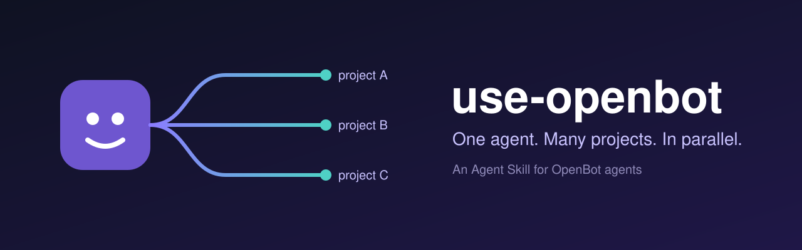
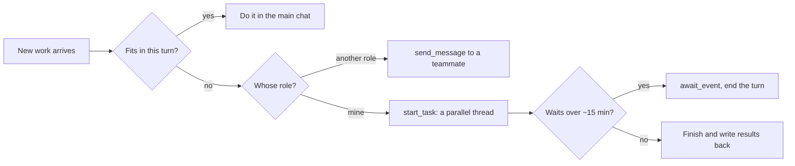

<p align="center">
  
</p>

<p align="center">
  <a href="LICENSE"></a>
  <a href="https://openbot.run/"></a>
  <a href="https://agentskills.io"></a>
</p>

<p align="center">
  <b>English</b> · <a href="README.zh-CN.md">简体中文</a>
</p>

---

**use-openbot** is an [Agent Skill](https://agentskills.io) that teaches agents running in [OpenBot](https://openbot.run/) to use OpenBot's own machinery: parallel tasks, thread history, teammate messages, waits, interrupts, and local skills.

With it, an agent that owns three projects opens three tasks and keeps going. It stops replying "I'm at capacity, let's queue this."

## Contents

- [Why](#why)
- [What your agent learns](#what-your-agent-learns)
- [Install](#install)
- [Pitfalls it covers](#pitfalls-it-covers)
- [Compatibility](#compatibility)
- [FAQ](#faq)
- [Contributing](#contributing)
- [License](#license)

## Why

OpenBot ships every agent with tool descriptions. They say **what** a tool does, but not **when** to reach for it or **what goes wrong**. So agents fall back to how a person works: one thing at a time, queue the rest.

| Without the skill | With the skill |
|---|---|
| "I'm busy with project A, B will have to wait." | Opens a task for B; the main chat stays free. |
| Polls a build in a loop and burns the turn. | Opens a wait and ends the turn. A routine or script wakes it. |
| Starts a task and waits for its result in the main chat, which never comes. | Writes the hand-off into the brief: where to save results, whom to message. |
| Updates a skill once and assumes everyone has it. | Re-installs the new revision for each agent and reads it back. |

## What your agent learns



| Mechanism | Tools | Covered |
|---|---|---|
| Parallel tasks | `start_task` | when to open one, what the brief needs, capacity, limits |
| Thread history | `history_read`, `history_search` | checking a task by `taskId`, recovering after compaction |
| Teammates | `send_message`, `expectsReply`, `replyToMessageId` | requests vs. notices, replies, no polling |
| Waits | `await_event`, `list_waits`, `close_wait` | routine and script wake-ups |
| Interrupts | `interrupt_agent` | what you can and cannot stop |
| Skills | `create_skill`, `install_local_skill`, `revise_skill`, `read_agent` | rolling a skill out to every agent and keeping it current |

The full text is in [`skills/use-openbot/SKILL.md`](skills/use-openbot/SKILL.md). It is about 90 lines, so it costs little context.

## Install

**Option A: ask an OpenBot agent (recommended).** This puts the skill in OpenBot's local library, where every agent can get it. Paste this to any agent:

```text
Download skills/use-openbot from https://github.com/kkunkunya/use-openbot into your workspace,
register it with openbot.create_skill, install it for every local agent with
openbot.install_local_skill, then confirm each one with openbot.read_agent.
```

**Option B: the skills CLI.** Run this in an agent's workspace or project folder:

```bash
npx skills add kkunkunya/use-openbot
```

**Then add one line to your agents' instructions.** OpenBot's built-in guidance says to start tasks only when the user asks. This line gives that standing permission:

```text
When several projects need work, use parallel tasks (start_task) by default.
```

## Pitfalls it covers

These were tested on OpenBot 0.62.

- A task's result **never returns to the main chat**.
- A task **cannot message its own agent** (`An agent cannot message itself`). It must report to someone else, or to a file.
- Tasks **cannot start tasks** (`Only your own chat can start a task`).
- Tasks share the workspace with **no file locks**. Give each task its own files or git worktree.
- By default, tasks are told **not to commit, switch, reset, stash, or rebase**. Say so in the brief if they should.
- Installed skills **do not update** when the library does.

## Compatibility

| | Status |
|---|---|
| OpenBot 0.62, desktop | ✓ tested |
| Claude provider inside OpenBot | ✓ tested |
| Other OpenBot providers | should work (the skill only uses OpenBot tools) |
| Terminal agents outside OpenBot | — (they do not have these tools) |

If a tool description disagrees with this skill, trust the tool description, and please [open an issue](https://github.com/kkunkunya/use-openbot/issues/new/choose).

## FAQ

**Is this official?**
No. It is a community skill and has no affiliation with the OpenBot team. Official sources are [openbot.run](https://openbot.run/) and [nightly-labs/openbot](https://github.com/nightly-labs/openbot).

**Doesn't OpenBot already ship skills?**
It bundles three managed skills, for data tables, site hosting, and skill creation. The marketplace has *Working With Teammate Agents*, which covers messaging. None of them cover parallel tasks, waits, or skill rollout.

**Won't parallel tasks collide?**
They can, because they share one workspace. The skill tells agents to split work by files or worktrees. Heavy shared resources, such as one machine's CPU or one production window, still need ordering.

## Contributing

Found a behaviour that changed in a newer OpenBot, or a pitfall we missed? Open an issue with your OpenBot version and the exact tool message. PRs that keep `SKILL.md` short are very welcome. See [CONTRIBUTING.md](CONTRIBUTING.md).

## License

[MIT](LICENSE). OpenBot itself is licensed separately by its authors.
