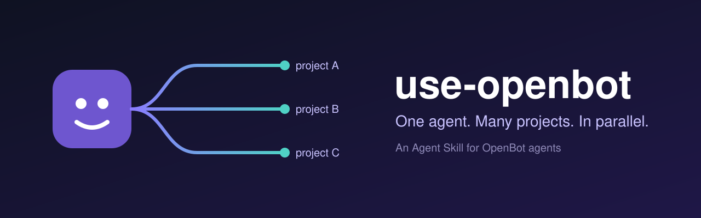
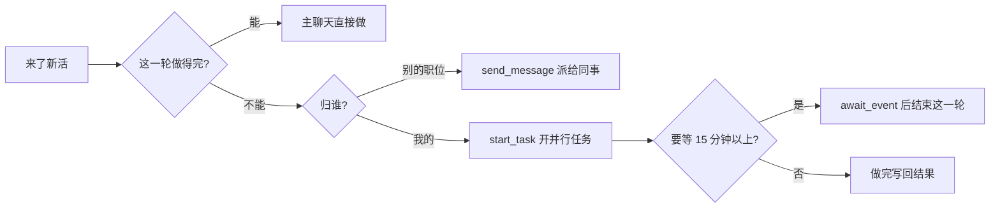

<p align="center">
  
</p>

<p align="center">
  <a href="LICENSE"></a>
  <a href="https://openbot.run/"></a>
  <a href="https://agentskills.io"></a>
  <a href="https://skills.sh/kkunkunya/use-openbot"></a>
</p>

<p align="center">
  <a href="README.md">English</a> · <b>简体中文</b>
</p>

---

**use-openbot** 是一个 [Agent Skill](https://agentskills.io)，教 [OpenBot](https://openbot.run/) 里的 agent 用好平台自己的机制：并行任务、看线程记录、给同事发消息、长等待和叫醒、打断、本地技能。

装上以后，一个管三个项目的 agent 会开三个任务同时推，不再回一句「我手上满了，先排队吧」。

## 目录

- [为什么要它](#为什么要它)
- [学会什么](#学会什么)
- [安装](#安装)
- [写进去的坑](#写进去的坑)
- [兼容性](#兼容性)
- [常见问题](#常见问题)
- [参与改进](#参与改进)
- [许可证](#许可证)

## 为什么要它

OpenBot 给每个 agent 的工具说明只讲某个工具**能做什么**，不讲**什么时候用**、**会踩什么坑**。于是 agent 照人的习惯干活：一次做一件，其余排队。

| 没装 | 装了 |
|---|---|
| 「我在忙项目 A，B 先等等。」 | 给 B 开个任务，主聊天继续收消息。 |
| 循环查构建状态，把这一轮耗光。 | 开一个等待就结束这一轮，等例程或脚本叫醒。 |
| 开了任务后在主聊天等结果，结果一直不来。 | 在任务说明里写清收尾：结果存哪、发给谁。 |
| 技能改了一次，以为大家都更新了。 | 给每个 agent 重装新版本，再逐个读回确认。 |

## 学会什么



| 机制 | 工具 | 讲了什么 |
|---|---|---|
| 并行任务 | `start_task` | 什么时候开、任务说明要写什么、容量和限制 |
| 线程记录 | `history_read`、`history_search` | 按 `taskId` 看任务进度，上下文压缩后找回细节 |
| 同事 | `send_message`、`expectsReply`、`replyToMessageId` | 请求和通知的区别、怎么回信、不轮询 |
| 等待 | `await_event`、`list_waits`、`close_wait` | 例程叫醒、本机脚本叫醒 |
| 打断 | `interrupt_agent` | 能停什么、不能停什么 |
| 技能 | `create_skill`、`install_local_skill`、`revise_skill`、`read_agent` | 把技能装给每个 agent，并保持最新 |

全文在 [`skills/use-openbot/SKILL.md`](skills/use-openbot/SKILL.md)，约 90 行，占的上下文很少。正文是英文，模型读中英文都没问题。

## 安装

**方式一：让 OpenBot 里的 agent 装（推荐）。** 这样技能进入 OpenBot 本地技能库，每个 agent 都能装。把下面这段发给任意一个 agent：

```text
把 https://github.com/kkunkunya/use-openbot 里的 skills/use-openbot 下载到你的工作目录，
用 openbot.create_skill 注册，再用 openbot.install_local_skill 装给每个本地 agent，
最后用 openbot.read_agent 逐个确认装上了。
```

**方式二：skills 命令行。** 在 agent 的工作目录或项目目录里运行：

```bash
npx skills add kkunkunya/use-openbot
```

**最后给 agent 的指令加一句。** OpenBot 内置的说明是「用户要求时才开任务」，这一句就是长期授权：

```text
有好几个项目要推时，默认开并行任务（start_task）同时推。
```

## 写进去的坑

以下都在 OpenBot 0.62 上实测过。

- 任务的结果**不会回到主聊天**。
- 任务**不能给自己的 agent 发消息**（报错 `An agent cannot message itself`），要发给别人或写进文件。
- 任务里**不能再开任务**（报错 `Only your own chat can start a task`）。
- 任务之间共用工作目录，**没有文件锁**。每个任务改自己的文件，或各开一个 git worktree。
- 平台默认叫任务**不要 commit、switch、reset、stash、rebase**，需要提交就在任务说明里写明。
- 技能库更新后，**已装的副本不会跟着更新**。

## 兼容性

| | 状态 |
|---|---|
| OpenBot 0.62 桌面版 | ✓ 实测 |
| OpenBot 里用 Claude 的 agent | ✓ 实测 |
| OpenBot 里的其他 provider | 应该可以（只用到 OpenBot 自己的工具） |
| OpenBot 之外的终端 agent | —（没有这些工具） |

工具说明和本技能对不上时，以工具说明为准，也欢迎[提 issue](https://github.com/kkunkunya/use-openbot/issues/new/choose)。

## 常见问题

**是官方出的吗？**
不是。这是社区自写的技能，和 OpenBot 团队没有关系。官方资料在 [openbot.run](https://openbot.run/) 和 [nightly-labs/openbot](https://github.com/nightly-labs/openbot)。

**OpenBot 不是自带技能吗？**
自带 3 个，分别管数据表、建站、写技能。市场里有 *Working With Teammate Agents*，讲找同事和回信。这些都没讲并行任务、等待和技能分发。

**并行任务会不会互相打架？**
会，因为它们共用一个工作目录。技能让 agent 按文件或 worktree 分开干。真正共用的资源，比如同一台机器的算力、同一个生产窗口，还是要排先后。

## 参与改进

发现新版 OpenBot 的行为变了，或者有我们没写到的坑？提 issue 时请带上 OpenBot 版本号和工具的原话。欢迎提 PR，`SKILL.md` 请保持精简。详见 [CONTRIBUTING.md](CONTRIBUTING.md)。

## 许可证

[MIT](LICENSE)。OpenBot 本身由其作者另行授权。
